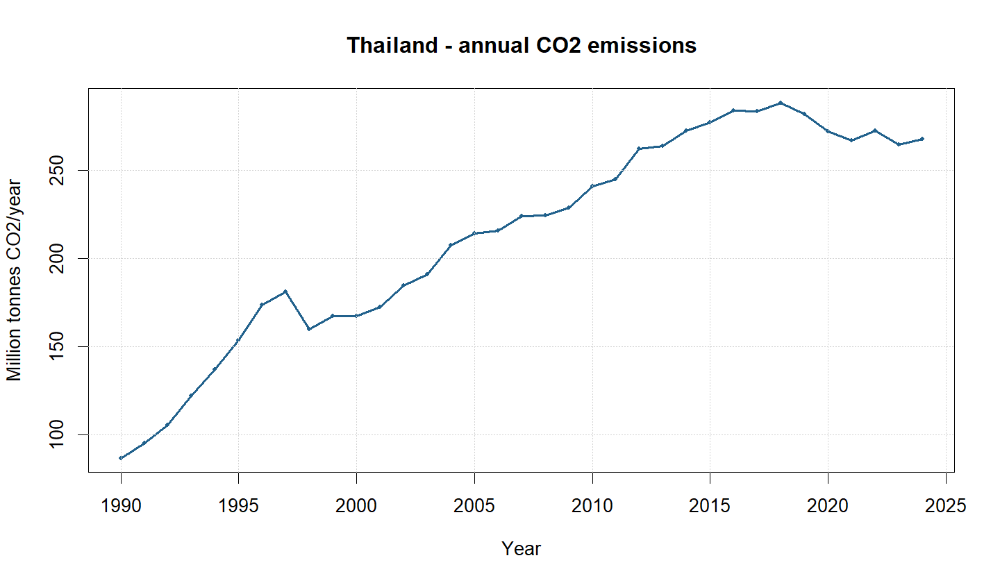
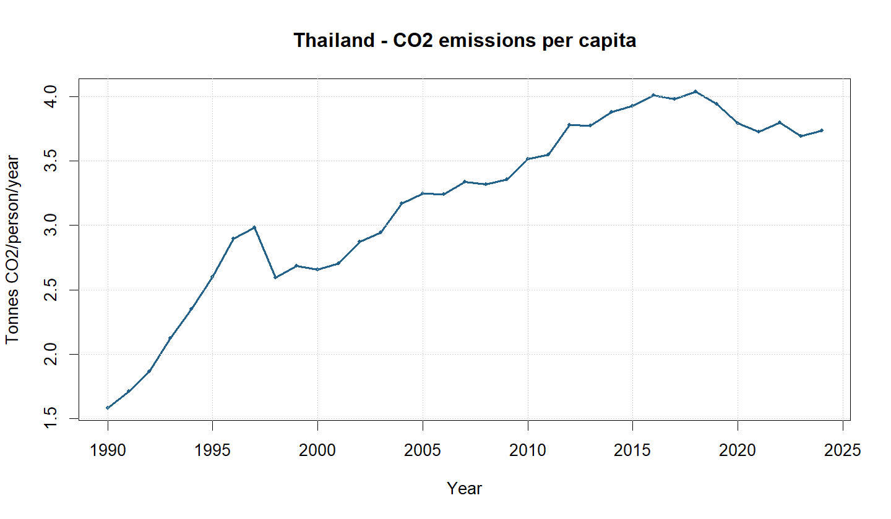
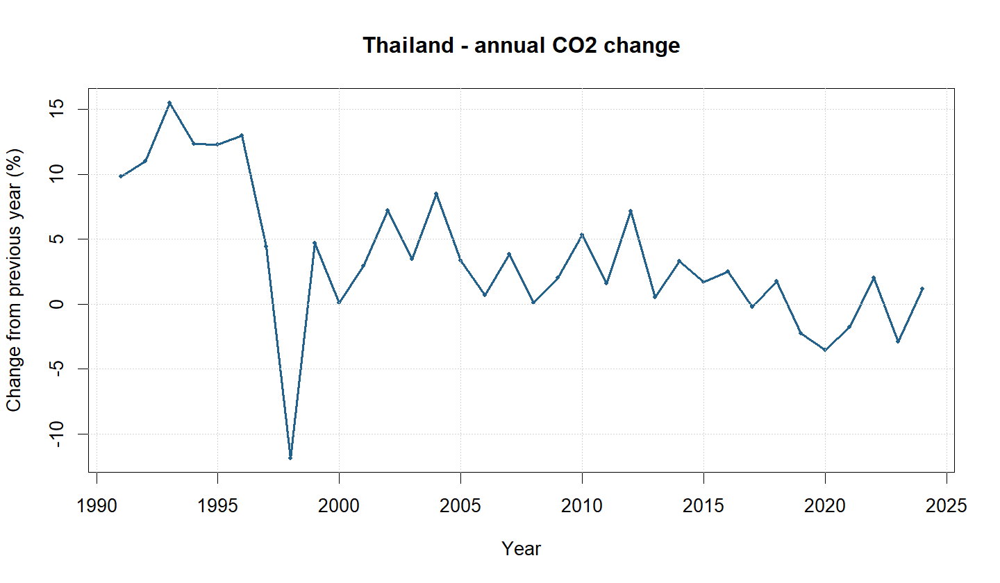

# CO₂ Emissions Analysis of Thailand (1990–2024)

Researcher/Author: Kian Rhay R. Alampay

---

## 1. Research Question

How have Thailand's annual CO₂ emissions and CO₂ emissions per capita changed from 1990 to 2024?

## 2. Country and Study Period

- **Country:** Thailand
- **Country Code:** THA
- **Study Period:** 1990–2024
- **Data Source:** Our World in Data (OWID)

This analysis examines the changes in Thailand's annual CO₂ emissions and CO₂ emissions per capita over a 35-year period.

## 3. Data Source

The dataset was obtained from Our World in Data:

https://ourworldindata.org/co2-emissions

The original dataset was downloaded from:

https://owid-public.owid.io/data/co2/owid-co2-data.csv

The analysis filtered the dataset to include only Thailand (THA) and the years 1990–2024. The full original dataset is excluded from the GitHub repository through `.gitignore`, while the country-specific CSV is included.

## 4. Software and Tools

The following software and tools were used:

- R version 4.5.2
- RStudio
- Git and GitHub
- R base functions and any required packages used in the analysis script

## 5. Instructions to Reproduce the Analysis

To reproduce the analysis:

1. Clone or download this GitHub repository.
2. Open the `co2-emissions-THA.Rproj` project in RStudio.
3. Make sure the required R packages are installed.
4. Open the `scripts/analyze_co2.R` script.
5. Run the script from the project root directory using:

```r
source("scripts/analyze_co2.R")
```

The script downloads the OWID dataset if it is not already available, filters the data for Thailand from 1990 to 2024, calculates the required values, and generates the figures and result files.

## 6. Important Results

The analysis showed that Thailand's annual CO₂ emissions increased from **86.56 million tonnes in 1990** to **267.76 million tonnes in 2024**, representing an overall increase of approximately **209.32%**.

The highest annual CO₂ emissions were recorded in **2018**, reaching approximately **288.30 million tonnes**. After 2018, emissions generally declined, although some fluctuations occurred.

CO₂ emissions per capita also increased from approximately **1.58 tonnes per person in 1990** to **4.04 tonnes per person in 2018**. By 2024, the value had decreased to approximately **3.74 tonnes per person**.

## 7. Figures

### Figure 1. Annual CO₂ Emissions in Thailand (1990–2024)



### Figure 2. CO₂ Emissions Per Capita in Thailand (1990–2024)



### Figure 3. Annual Percentage Change in CO₂ Emissions (1990–2024)



## 8. Interpretation and Discussion

The results show that Thailand's annual CO₂ emissions generally increased from 1990 to 2024. Emissions rose from 86.56 million tonnes in 1990 to 267.76 million tonnes in 2024, representing an overall increase of approximately 209.32%. The highest emission level was recorded in 2018, reaching 288.30 million tonnes. After this peak, emissions generally declined, although some fluctuations occurred in the following years.

Similarly, CO₂ emissions per capita increased from 1.58 tonnes per person in 1990 to 4.04 tonnes per person in 2018. However, this value decreased to 3.74 tonnes per person in 2024. This pattern indicates that the amount of CO₂ emitted per person was higher in 2018 compared with the latest year included in the analysis.

The overall increase in emissions may be associated with Thailand's growing energy consumption and economic activities. Adebayo and Akinsola (2021) discussed the relationship between economic growth, energy consumption, and CO₂ emissions in Thailand. Their findings provide relevant context for understanding the increasing trend observed in this analysis.

Although emissions decreased after 2018, the 2024 value remained considerably higher than the 1990 level. Therefore, the results suggest that Thailand experienced substantial growth in CO₂ emissions over the study period. However, this analysis is descriptive and cannot establish the specific causes of the observed changes.

## 9. Limitations

This analysis is limited to Thailand and covers only the period from 1990 to 2024. It focuses on annual CO₂ emissions and emissions per capita. It does not directly measure other greenhouse gases or determine the specific causes of changes in emissions. The analysis is descriptive and does not establish a cause-and-effect relationship between economic activities, energy consumption, and CO₂ emissions.

## 10. References

Adebayo, T. S., & Akinsola, G. D. (2021). Investigating the causal linkage among economic growth, energy consumption and CO₂ emissions in Thailand: An application of the wavelet coherence approach. *International Journal of Renewable Energy Development, 10*(1), 17–26. https://doi.org/10.14710/ijred.2021.32233

Our World in Data. (n.d.). *CO₂ emissions*. https://ourworldindata.org/co2-emissions